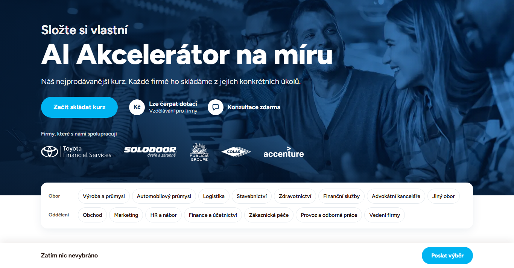
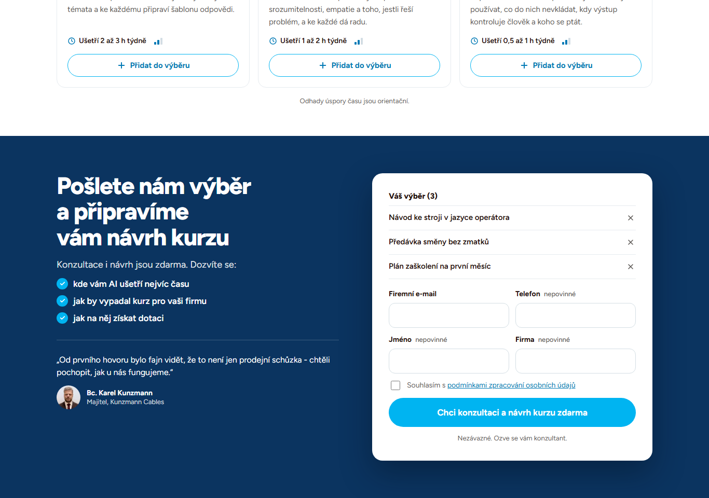
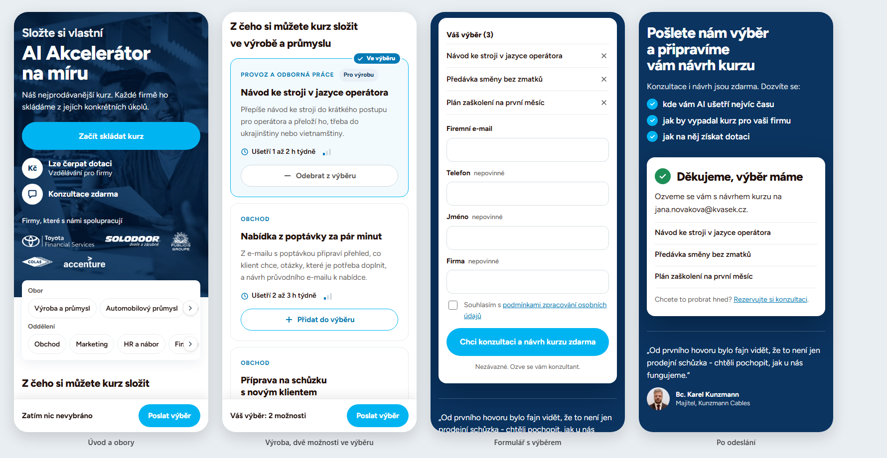

# Složte si vlastní AI Akcelerátor

Lead magnet pro LifeScale Business, dřív „AI mapa pro firmy“. Cílí hlavně na výrobní firmy s 50 až 250 zaměstnanci, které si neumí představit, k čemu by u nich AI byla. Návštěvník si podle oboru vybere, s čím by AI pomohla jeho lidem, a pošle výběr. Konzultant LifeScale mu z něj připraví návrh kurzu AI Akcelerátor na míru. Koncept je z porady Ondřeje Kamarýta a Martina Ptáčka 4. 11. 2026.







## Jak to funguje

1. Úvod s fotkou: „Složte si vlastní AI Akcelerátor na míru“, jedna věta o kurzu, tlačítko „Začít skládat kurz“, ikony „Lze čerpat dotaci Vzdělávání pro firmy“ a „Konzultace zdarma“ a pět log firem (pole `LOGA` v `src/data.js`).
2. Pod úvodem jsou dva řádky filtru: obory (výroba je první) a oddělení. Bez vybraného oboru a oddělení stránka ukáže šest snadných možností, každou z jiného oddělení (pole `START` v `src/app.js`), a tlačítko „Zobrazit všech 42 možností“. Po výběru oboru nebo oddělení ukáže všechny možnosti, které k němu patří, seřazené od nejsnazších. Oba filtry platí zároveň. Obtížnost ukazuje ikona se třemi sloupečky: snadné mají vyplněný jeden, střední dva.
3. Každá karta říká, co možnost přinese a kolik času týdně ušetří, a má jediné tlačítko: „Přidat do výběru“, případně „Odebrat z výběru“. Detail s postupem a pokynem pro AI už stránka nemá.
4. U spodního okraje je pořád vidět lišta s počtem vybraných možností a tlačítkem „Poslat výběr“, které vede k formuláři. Když je formulář na obrazovce nebo se do něj píše, lišta uhne.
5. Závěr stránky je tmavá sekce „Pošlete nám výběr a připravíme vám návrh kurzu“: tři krátké body, co se návštěvník na konzultaci dozví, jedna reference a formulář s výběrem, ze kterého jde odebírat. Povinný je jen e-mail a souhlas se zpracováním údajů, jméno, telefon a firma jsou nepovinné. Odeslat jde i prázdný výběr, konzultant ho pak projde s návštěvníkem.
6. Po odeslání stránka poděkuje, ukáže shrnutí výběru a malý odkaz na rezervaci konzultace v Calendly. Potvrzení se ukáže až ve chvíli, kdy web LifeScale kontakt převezme. Když se to nepovede, formulář zůstane vyplněný a stránka nabídne odeslat znovu.
7. Dole je skrytý „Pohled konzultanta“. Ukazuje kontakt, shrnutí pro Slack a celé pole Zajem. Na webu LifeScale se nezobrazuje.

## Spuštění

Otevřete `index.html` v prohlížeči. Stránka nepotřebuje server ani instalaci, písma si načte z Google Fonts a fotku v úvodu z LifeScale CMS. Samostatně otevřená stránka kontakt nikam neposílá, potvrzení je jen náhled pro tým.

## Struktura

| Soubor | Co obsahuje |
| --- | --- |
| `index.html` | sestavená stránka, tu otevírejte a nasazujte |
| `src/head.html` | titulek, popis, odkazy na písma a všechny styly |
| `src/body.html` | obsah stránky |
| `src/data.js` | obory, oddělení, loga a všech 42 možností |
| `src/app.js` | filtry a řazení, výběr, lišta, formulář a předání kontaktu webu |
| `build.sh` | složí `src/` do `index.html` a do `dist/artifact.html` pro Claude |
| `cms/html-blok.html` | HTML blok pro stránku v LifeScale CMS, viz níže |
| `podklady/postupy.json` | postupy, pokyny pro AI a upozornění ke všem možnostem jako podklad pro návrh kurzu. Na stránce nejsou a do veřejného repozitáře nejdou, soubor je jen v pracovní složce. |
| `tests/` | automatický průchod stránkou na telefonu a notebooku |
| `tools/nbsp.py` | doplní pevné mezery za jednopísmenné předložky a spojky |

## Vložení na web LifeScale

Na webu běží stránka z LifeScale CMS (Directus) s jedním HTML blokem z `cms/html-blok.html`. Blok zobrazí stránku z GitHub Pages přes celou obrazovku pod hlavičkou webu.

- Stránka pozná, že je vložená, a schová vlastní hlavičku a pohled konzultanta.
- Po odeslání formuláře pošle kontakt a pole `zajem` stránce zprávou `postMessage` typu `ls-ai-mapa-lead`, a to jen na `https://business.lifescale.cz`. Stránka webu přijímá zprávy jen z `https://ondrejkamaryt.github.io`.
- Stránka webu kontakt odešle na `/api/form-submit` stejně jako formuláře webu, se scénářem `general_inquiry` a poli Vaše jméno, E-mail, Telefon, Firma, Zajem a GDPR. Odtud jde do `form_submissions` a webhookem do Make, který lead ohlásí v kanálu #lifescale-leads. Výsledek vrátí zprávou `ls-ai-mapa-lead-ack` a podle ní stránka ukáže potvrzení, nebo chybu.

### Pole Zajem

JSON s obsahem výběru. Jako první je hotové textové shrnutí, které stačí v Make vložit do zprávy ve Slacku:

```json
{
  "shrnuti": "AI Akcelerátor na míru\nObor: Výroba a průmysl\nOddělení: Provoz a odborná práce\nVýběr (2):\n• Návod ke stroji v jazyce operátora (Provoz a odborná práce)\n• Předávka směny bez zmatků (Provoz a odborná práce)",
  "v": 2,
  "zdroj": "AI mapa: AI Akcelerátor na míru",
  "obor": "Výroba a průmysl",
  "obor_id": "vyroba",
  "oddeleni": "Provoz a odborná práce",
  "oddeleni_id": "provoz",
  "pocet": 2,
  "vyber": [
    { "id": "vy1", "nazev": "Návod ke stroji v jazyce operátora", "oddeleni": "Provoz a odborná práce" },
    { "id": "p3", "nazev": "Předávka směny bez zmatků", "oddeleni": "Provoz a odborná práce" }
  ]
}
```

Bez vybraného oboru je `obor` i `obor_id` `null` a ve shrnutí „Obor: nevybrán“. Bez vybraného oddělení je `oddeleni` i `oddeleni_id` `null` a řádek „Oddělení“ ve shrnutí chybí. Prázdný výběr má `pocet` 0 a ve shrnutí „Výběr: nic nevybráno, zeptat se při hovoru“. Postup a pokyn ke každé možnosti najde konzultant podle `id` v `podklady/postupy.json`.

## Úprava obsahu

Možnosti jsou v `src/data.js` v poli `UC`. Každá má tato pole:

| Pole | Význam |
| --- | --- |
| `id` | jedinečný kód, třeba `o1` |
| `d` | oddělení: `obchod`, `marketing`, `hr`, `finance`, `pece`, `provoz` nebo `vedeni` |
| `i` | obory, pro které je možnost určená, prázdné pole znamená všechny obory |
| `u` | úspora v hodinách týdně na člověka ve tvaru `[od, do]` |
| `l` | obtížnost: `s` snadné, `m` střední |
| `t`, `w` | název a co možnost přinese |

Pořadí oborů určuje pole `OBORY`, šest úvodních možností pole `START` v `src/app.js`. Po úpravě spusťte:

```
python3 tools/nbsp.py src/body.html src/data.js src/app.js
./build.sh
```

## Testy

Potřebujete Python s Playwrightem. Prohlížeč stačí nainstalovaný Chrome.

```
pip install playwright
PW_CHANNEL=chrome python3 tests/test_flow.py
```

Test proklikne obory, oddělení, rozbalení všech možností, řazení podle obtížnosti, přidání a odebrání na kartě i ve formuláři, lištu, kontrolu formuláře a odeslání. Ve vloženém režimu podstrčí potvrzení od webu LifeScale jednou chybné a jednou úspěšné. Snímky obrazovky uloží do `tests/out/`.

## Před ostrým spuštěním

- Doplnit do scénáře v Make pole Zajem: přidat Parse JSON a do zprávy v #lifescale-leads vložit `shrnuti`, aby konzultant výběr viděl ve Slacku i v Pipedrivu. Když JSON nepůjde načíst, vložit text pole celý.
- Přesunout stránku z osobního GitHubu na firemní hosting a změnit adresu v `cms/html-blok.html` i v `PARENTS` v `src/app.js`.
- Doplnit stránce v CMS titulek a popis pro vyhledávače a do HTML bloku v CMS přenést nový titulek iframe z `cms/html-blok.html`.
- Potvrdit tvrzení na stránce: „nejprodávanější kurz“, úsporu „v řádu dní měsíčně“ (věta z webu LifeScale) a „Nezávazné“.
- Upřesnit dotaci: výzva uznává podporu účastníkovi, který absolvuje aspoň 50 hodin, a standardní AI Akcelerátor má 12 hodin. Stránka teď říká „Lze čerpat dotaci“ bez této podmínky, konzultant ji musí vysvětlit.
- Rozhodnout, jestli loga zůstanou bez upřesnění: jsou z bloku „Firmy, které s námi spolupracují“ na webu, ne všechny musely absolvovat právě AI kurz. Reference Karla Kunzmanna je zkrácená citace z webu.
- Nahradit písmo Figtree písmem Satoshi z webu.
- Ztmavit modrá tlačítka. Bílé písmo na #00B4F1 má kontrast 2,4 : 1, pro dobrou čitelnost je potřeba aspoň 4,5 : 1. Stránka zatím drží barvy webu LifeScale.
- Odstranit pohled konzultanta a štítek Prototyp.

## Licence

Kód je interní materiál LifeScale.
